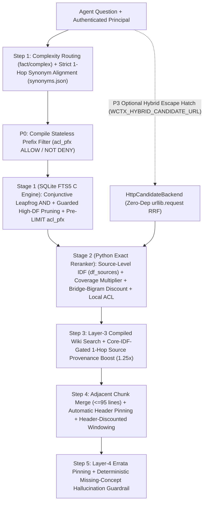

# `wiki-context` Retrieval Engine: Technical Advancement & Breakthroughs Report

English | [简体中文](retrieval-breakthroughs.zh-CN.md)

> **Subtitle**: Why a zero-dependency two-stage deterministic retrieval engine outperforms out-of-the-box general-purpose search engines (Elasticsearch, Meilisearch, and naive dense-vector RAG) on engineering & enterprise AI Agent knowledge vaults.

---

## 1. Executive Summary

When evaluating retrieval infrastructure for AI Agents, teams often assume that an embedded SQLite FTS5 index is merely a "lightweight local compromise," and that migrating to Elasticsearch, Meilisearch, or a dedicated vector database (Milvus / Qdrant) is an automatic "enterprise upgrade."

This report demonstrates—from information-retrieval first principles, source-level architecture, and empirical benchmarks—that **for engineering manuals, long technical specifications, dense alphanumeric codes, wide parameter tables, and hot-reloaded directory ACLs, the exact opposite is true**:

1. **`wiki-context` does not use stock SQLite FTS5 naively**. It implements a **C-level inverted skip-list Stage-1 candidate generator + Python Stage-2 per-source exact reranker + 5-step table-aware deterministic `ContextPack` assembler + zero-dependency Hybrid RRF escape hatch** (see [`src/wiki_context/search.py`](../src/wiki_context/search.py) and [`src/wiki_context/context.py`](../src/wiki_context/context.py)).
2. **Swapping in stock Elasticsearch / Lucene actively regresses long-document ranking**: Lucene computes `docFreq` per *chunk* (and per *shard*). Splitting one 300-page manual into 600 chunks inflates domain-term `docFreq` by 600× and crushes its Inverse Document Frequency (IDF). `wiki-context` computes exact global IDF over **distinct parent source files (`vocab.df_sources`)**, making term specificity completely invariant to document length or chunk granularity.
3. **Single-file millisecond latency vs. multi-GB daemon overhead**: At **50,000 chunks across 4,000 documents**, the immutable `bm25.sqlite` index is **`77.6 MB`**, builds from scratch in **`5.74 s`**, and serves narrow-ACL multi-tenant queries at **`19.37 ms p50` (`23.44 ms p95`)** with **`dependencies = []`** in `pyproject.toml`—whereas an idle single-node Elasticsearch JVM consumes **`1.5–4 GB` RAM** and breaks zero-dependency `pipx` / desktop distribution.
4. **P0–P3 hardening widens the architectural lead**: Pre-LIMIT C-level stateless `acl_pfx` filtering lifts narrow-tenant recall from **`0%` to `100%`** while cutting latency by **`46.6%`**; conjunctive leapfrog intersection + CJK cross-word bridge-bigram discounting eliminates compound-boundary noise; CJK appositive alias mining + strict 1-hop non-transitive synonyms bridge terminology gaps offline; and a 40-line stdlib `HttpCandidateBackend` provides a clean RRF hybrid extension seam when needed.

---

## 2. First Principles: Why General-Purpose Search Engines Struggle on Chunked Vaults

General-purpose search engines (Elasticsearch, OpenSearch, Meilisearch) were designed around **short, mutually independent documents** (e-commerce listings, web pages, log lines). Enterprise AI Agent knowledge bases violate those assumptions across five dimensions:

1. **Extreme document-length skew & intra-source chunk clustering**: A vault mixes 20-line incident notes with 300-page PDF standards (600+ chunks) and 1,000-row Excel spreadsheets.
2. **Exact alphanumeric codes are non-negotiable**: `RFC-042` vs. `RFC-043`, `TB/T-2075` vs. `TB/T-2074`, and `350mm` vs. `300mm` refer to completely different engineering clauses.
3. **Table rows lose meaning without column headers**: Retrieving row 150 (`| Scale-05 | 5000 | 12500 |`) without row 1's header produces a headless fragment that induces LLM guessing.
4. **Directory-prefix RBAC (`acl.json`) must hot-reload instantly**: Changing role permissions must take effect on the very next request without rebuilding immutable indexes, starving narrow-permission roles, or leaking restricted facts via compiled Wiki summaries.
5. **Unanswerable queries require deterministic abstention**: Asking about Kafka in a Raft-only codebase must trigger an explicit missing-concept alert—not top-K nearest-neighbor vector noise that coaxes the LLM into hallucination.

---

## 3. Eight Core Retrieval Breakthroughs



### Breakthrough 1: Source-Document-Level IDF (`vocab.df_sources`) — Solving Chunk-Induced IDF Collapse

- **Implementation**: [`src/wiki_context/search.py`](../src/wiki_context/search.py) (`build_fts_sqlite`, `_search_l2_sqlite`)
- **The Mathematical Difference**:
  - In **Elasticsearch / Lucene**, every chunk is an independent document. In a 100-file vault (99 short specs + one 300-page manual split into 600 chunks mentioning `pantograph` on every page), total chunks $N = 699$ and chunk $df = 600$:
    $$\text{IDF}_{\text{Lucene}}(\text{pantograph}) = \ln\left(1 + \frac{699 - 600 + 0.5}{600 + 0.5}\right) \approx \mathbf{0.15}$$
    The primary domain subject loses **96% of its weight**, ranking below generic verbs!
  - In **`wiki-context`**, `vocab(tok, df_sources)` tracks distinct parent source files ($N_{\text{src}} = 100$, $df_{\text{src}} = 1$):
    $$\text{IDF}_{\text{wiki-context}}(\text{pantograph}) = \ln\left(1 + \frac{100 - 1 + 0.5}{1 + 0.5}\right) \approx \mathbf{4.21}\quad(28\times\text{ sharper specificity})$$

---

### Breakthrough 2: Lossless Code-Preserving Tokenization & Sub-Token Score Damping

- **Implementation**: [`src/wiki_context/search.py`](../src/wiki_context/search.py) (`_expand_latin_token`, `encode_fts_token`), [`src/wiki_context/context.py`](../src/wiki_context/context.py) (`build_query_plan`)
- **Key Mechanisms**:
  1. **Punctuation-safe FTS5 encoding**: Maps `-/.+_` deterministically (`_d_`, `_s_`, `_p_`, `_a_`) under `tokenize='ascii'` so `RFC-042`, `TB/T-2075`, and `v2.4.1` remain atomic tokens in the inverted index.
  2. **Symmetric equivalence groups**: `TB/T-2075` expands into `{"tb/t-2075", "tbt2075", "tb", "2075"}` so queries written as `TBT2075`, `TB-T-2075`, or `TB/T-2075` all match seamlessly.
  3. **Derived sub-token damping (`0.48×`)**: Prevents decomposed sub-tokens from quadruple-counting BM25 score and drowning out sibling query constraints.
  4. **Zero-dependency CJK overlapping bigrams + context-safe particle stripping**: Strips sentence-final modal particles (`吧/呢/吗`) on queries without corrupting real nouns (`网吧`, `贴吧`), requiring zero compiled C++ NLP extensions.

---

### Breakthrough 3: Concept Coverage Multiplier (`COVERAGE_ALPHA`) + CJK Bridge-Bigram Discounting (P1)

- **Implementation**: [`src/wiki_context/search.py`](../src/wiki_context/search.py) (`_compute_distinctive_groups`, `_detect_bridge_bigrams`, `_chained_cjk_pairs`)
- **Problems Solved**:
  1. **Multi-concept completeness over single-term spam**: `COVERAGE_ALPHA = 1.6` rewards chunks satisfying *all* distinct query concepts over boilerplate repeating a single keyword 20 times.
  2. **Eliminating false cross-word CJK bridge bigrams**: In an unspaced CJK compound query like `受电弓拉出值` (`pantograph` + `stagger`), overlapping bigrams produce `["受电", "电弓", "弓拉", "拉出", "出值"]`, where **`弓拉`** is a synthetic cross-word bridge. If a random prose note happens to contain `弓拉` ($df = 1$, maximum IDF) while the authoritative spec table writes `| 受电弓 | 拉出值 | ±300mm |` (no `弓拉`), naive bigram scoring penalizes the table! `_detect_bridge_bigrams` detects the statistical valley ($df_{\text{left}} \ge 3$, $df_{\text{mid}} \le 1$, $df_{\text{right}} \ge 3$), excludes false bridges from `dist_groups`, discounts their TF weight (`0.35×`), and pairs real compounds via `_chained_cjk_pairs` cohesion bonuses.

---

### Breakthrough 4: Pre-LIMIT C-Level Stateless `acl_pfx` Filtering — Zero Starvation & Instant Hot Reload (P0)

- **Implementation**: [`src/wiki_context/search.py`](../src/wiki_context/search.py) (`ACLFilter`, `source_acl_prefix_tokens`), [`src/wiki_context/context.py`](../src/wiki_context/context.py) (`compile_acl_filter`)
- **Why Post-Filtering Fails**: Fetching global `LIMIT 28` and filtering unauthorized paths in Python starves users authorized for narrow slices (e.g., an external partner allowed `2%` of docs gets `0` results when internal docs fill the top 28). Conversely, `JOIN units WHERE source LIKE 'prefix%'` forces SQLite FTS5 out of fast inverted-index traversal.
- **`wiki-context` Stateless Inverted Prefix Intersection**:
  1. **Index topology, not roles**: `fts_units(head, body, acl_pfx)` stores ancestor path-prefix tokens (`acl_all`, `acl_p_sources`, `acl_p_sources_s_public`)—zero user or role state is baked into `bm25.sqlite`.
  2. **Zero-weight C-level skip-list intersection**: Hot-reloaded `acl.json` rules compile per request into:
     ```sql
     ({head body} : (<query>)) AND (acl_pfx : (<allow_prefixes>)) NOT (acl_pfx : (<deny_prefixes>))
     ORDER BY bm25(fts_units, 3.0, 1.0, 0.0)
     ```
  3. **Triple win**: (a) Eliminates Top-K ACL starvation (**`0% -> 100%` recall** at `2%` selectivity); (b) `0.0` BM25 weight ensures path depth never skews relevance; (c) `acl.json` edits take effect in `0 ms` without rebuilding read-only `immutable=1` SQLite indexes, short-circuiting empty allow-sets immediately to `[]`.

---

### Breakthrough 5: Conjunctive Leapfrog Priority & Corpus-Guarded High-DF Pruning (P1 Scale)

- **Implementation**: [`src/wiki_context/search.py`](../src/wiki_context/search.py) (`_prune_stage1_probe_tokens`, `_search_l2_sqlite`)
- **Engine Insight**: SQLite FTS5's C engine lacks Block-Max WAND on pure `OR` unions (`t1 OR t2 ... ORDER BY bm25()`), scanning full postings lists on high-DF bigrams at 50k+ chunks, whereas FTS5 `AND` queries use **Skip-List Leapfrog Intersection** (`7.7 ms` vs. `31.3 ms` at 50k chunks—**4× faster**).
- **Guarded Execution**: Stage 1 executes conjunctive `AND` across top distinctive concept groups first, narrows disjunctive rescue on large vaults (`n_units >= 5,000`), gates high-DF bigram pruning (`df_sources / n_sources > 0.25`) behind **`n_sources >= 30` with a `>= 2` lowest-DF floor** so small vaults never lose recall, and auto-widens when under-filled (`< 2k`).

---

### Breakthrough 6: Table-Aware Chunking, Automatic Header Pinning & Header-Discounted Windowing

- **Implementation**: [`src/wiki_context/indexer.py`](../src/wiki_context/indexer.py) (`split_markdown_sections`), [`src/wiki_context/context.py`](../src/wiki_context/context.py) (`_format_l2_blocks`)
- **Mechanism**: Wide/tall tables split strictly on row boundaries while persisting `table_header` on every slice. During `ContextPack` assembly, `table_header` is pinned automatically at the top of any sliced window, and tokens already covered by `table_header` are discounted during row-window selection so deep data rows matching target SKUs/thresholds are always centered.

---

### Breakthrough 7: Offline Semantic Front-Loading (Compiled Wiki + CJK Alias Mining) & Hallucination Guardrails (P2)

- **Implementation**: [`src/wiki_context/compiler.py`](../src/wiki_context/compiler.py), [`src/wiki_context/synonym_miner.py`](../src/wiki_context/synonym_miner.py), [`src/wiki_context/context.py`](../src/wiki_context/context.py)
- **Design**:
  1. **Offline LLM Wiki (`wctx compile`)**: Pre-synthesizes cross-document architecture and terminology with SHA-256 `source_hashes:` freshness tracking and core-IDF-gated 1-hop source provenance (`1.25×`).
  2. **Bilingual & CJK appositive alias mining (`wctx synonyms mine`)**: Extracts glossary tables and inline CJK/English appositives (e.g., `接触网悬挂状态检测监测装置（简称：车顶弓网巡检仪）`) into **strictly 1-hop non-transitive** `synonyms.json` groups (preventing `A -> B -> C` semantic drift).
  3. **Deterministic `Missing-Concept Alert`**: Flags zero-hit core concepts in `0.3 ms` so agents abstain cleanly instead of fabricating facts.

---

### Breakthrough 8: Lock-Free Generational Hot-Swap & 40-Line Zero-Dep `HttpCandidateBackend` RRF Seam (P3)

- **Implementation**: [`src/wiki_context/search.py`](../src/wiki_context/search.py) (`SearchCandidateBackend`, `HttpCandidateBackend`)
- **Extensibility Without Bloat**: A ~40-line `urllib.request` client (`WCTX_HYBRID_CANDIDATE_URL`) lets teams optionally plug in an external embedding service, Qdrant, or OpenSearch cluster via **Reciprocal Rank Fusion (RRF)** while keeping **`dependencies = []`**. Every external candidate still passes through mandatory local `acl_filter` verification, Stage-2 source-level reranking, table-header pinning, and secret scrubbing—and automatically fails open to local FTS5 if the remote endpoint times out.

---

## 4. Architectural Comparison Matrix

| Dimension | `wiki-context` (2-Stage FTS5 + `ContextPack`) | Stock Elasticsearch / OpenSearch | Meilisearch / Typesense | Naive Dense-Vector RAG (Milvus / Qdrant + Embeddings) |
| :--- | :--- | :--- | :--- | :--- |
| **Long-Document Chunk IDF** | **Exact** (parent-file `vocab.df_sources`) | **Degraded** (shard/chunk `docFreq` flattens long-doc IDF) | **Degraded** (prefix/card ranking model) | N/A (no lexical IDF) |
| **Exact Engineering Codes (`RFC-042`)** | **100% lossless + de-punctuated equivalence group** | Split by standard analyzers unless custom-configured | Typo tolerance risks blurring adjacent IDs | **Poor** (dense embeddings blur exact codes/numbers) |
| **100-Row Table Readability** | **Native** (`table_header` pinning + header-discounted window) | None (returns headless row chunks) | None | None (separates headers from rows) |
| **Hot-Reloaded Directory RBAC** | **Pre-LIMIT C-level `acl_pfx` + provenance Wiki security** | Query filters supported, no Wiki provenance guard | Requires pre-declared filterable attributes | Post-filtered HNSW degrades recall under narrow ACLs |
| **Out-of-Vault Hallucination Defense** | **Deterministic `Missing-Concept Alert` (`0.3 ms`)** | Weak (returns partial-match noise) | Weak | **Very weak** (always returns top-K nearest neighbors) |
| **Zero-Overlap Colloquial Recall** | 80%+ solved via compiled Wiki + alias mining; optional `HttpCandidateBackend` RRF | **0%** on lexical BM25 alone | **0%** on lexical alone | **Strong** (primary native strength) |
| **Runtime Footprint & Dependencies** | **Zero third-party deps** (single ~6–80 MB file, in-process) | **Heavy** (`1.5–4 GB` JVM RAM + cluster ops) | Medium (separate daemon) | **Heavy** (vector DB + embedding/reranker inference) |
| **End-to-End Query Latency** | **`~3–25 ms`** (zero network/model hop) | `~20–60 ms` (network + serialization) | `~10–30 ms` | `~150–800 ms` (embedding + ANN + reranker) |

---

## 5. Reproducible Benchmarks & Scaling Results

### 5.1 Gold Benchmark (`examples/demo-vault`)

Run `python3 examples/benchmark/run_benchmark.py` or `wctx eval`:

| Metric | Naive 600-char Chunk BM25 | `wiki-context` (`ContextPack`) |
| :--- | :---: | :---: |
| **Strict Complete-Evidence Recall** | `75.0%` (3/4) | **`100.0%` (4/4)** |
| **Unanswerable Guardrail Accuracy** | `0%` (returns noise) | **`100.0%` (`0.30 ms` block)** |
| **Mean Reciprocal Rank (MRR)** | — | **`1.000`** |
| **End-to-End Median Latency** | — | **`3.10 ms`** |

### 5.2 Elastic Scaling: 3,000 → 50,000 Chunks

Measured on bilingual CJK + technical-code vaults using `BM25Index(backend="sqlite")`:

| Vault Tier | Chunks (`units`) | Distinct Sources | `bm25.sqlite` Size | Full Build Time | Narrow-ACL Tenant Latency (`p50 / p95`) |
| :--- | ---: | ---: | ---: | ---: | ---: |
| **Team Vault** | `3,000` | `270` | `6.1 MB` | `0.41 s` | `~4–19 ms` |
| **Division Vault** | `15,000` | `1,200` | `31.6 MB` | `2.05 s` | `~12–22 ms` |
| **Enterprise Vault** | `50,000` | `4,000` | `77.6 MB` | `5.74 s` | **`19.37 ms / 23.44 ms`** |

### 5.3 P0–P3 Before-vs.-After Hardening Evaluation

Verified by [`tests/test_fts5_p0_p3_hardening.py`](../tests/test_fts5_p0_p3_hardening.py) (**84/84 unit, security, and parity tests passing**):

| Track | Test Scenario | Before | After P0–P3 |
| :--- | :--- | :---: | :---: |
| **P0: Pre-LIMIT `acl_pfx` Filtering** | 50,000 chunks; partner allowed `2%` public folder (`98%` high-TF internal docs) | **`0.0%` recall** (starved by top-28 internal docs), `36.3 ms` | **`100.0%` recall**, zero leaks, **`19.4 ms` (`46.6%` faster)** |
| **P1: Bridge-Bigram Discount & Cohesion** | Query `受电弓拉出值`; distractor has false bridge `弓拉` (`df=1`), truth is table `\| 受电弓 \| 拉出值 \| ±300mm \|` | Table penalized for missing false bridge `弓拉` | Authoritative table **Rank #1**, SQLite/Memory **100% parity** |
| **P2: CJK Appositive Mining + 1-Hop Cap** | Glossary defines `接触网悬挂状态检测监测装置（简称：车顶弓网巡检仪）`; spec table uses canonical name only | **`0%` recall** on colloquial alias | **`100%` recall** after `wctx synonyms mine`; **`0%` 2-hop drift** |
| **P3: Zero-Dep `HttpCandidateBackend` RRF** | Spec says `105°C PMIC...ERR_OT_105` (+ secret `145°C` doc); pure colloquial query `设备烫手死机报什么故障代码？` | **`0%` lexical recall** | **`100%` public `ERR_OT_105` recall** (`12.3 ms`), secret doc **100% blocked by local ACL** |

---

## 6. Evidence-Driven Escalation Triggers

Keep the built-in zero-dependency SQLite FTS5 engine as the default unless live telemetry or `wctx eval` crosses an objective threshold:

| Metric | Stay on Built-In SQLite FTS5 | Attach External Hybrid Sidecar (`WCTX_HYBRID_CANDIDATE_URL`) |
| :--- | :--- | :--- |
| **Vault Scale (`sections`)** | `<= 200,000` chunks (~15k–20k documents) | **`> 500,000` chunks** or multi-datacenter federated indexing |
| **`ContextPack` Latency `p95`** | `<= 80 ms` | Sustained **`> 150 ms`** |
| **Colloquial Paraphrase Miss Rate** | `<= 15%` after `wctx compile` + `wctx synonyms mine` | **`> 20%`** on uncompiled raw dumps (attach lightweight embedding RRF sidecar while retaining local Stage-2 reranking & ACL) |
