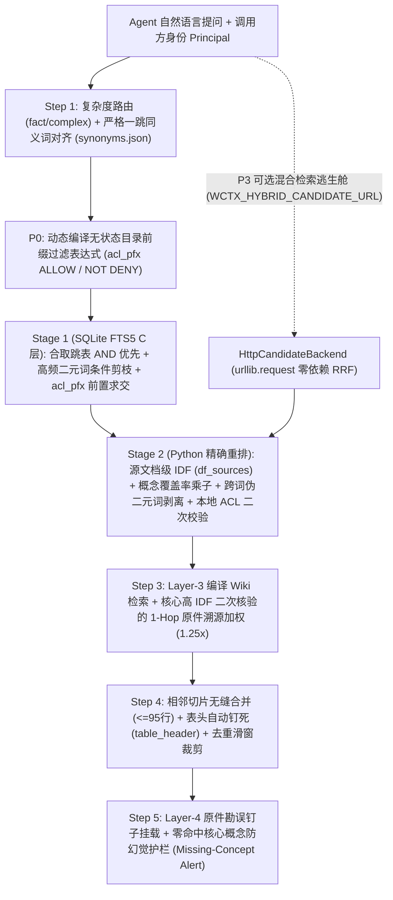

# `wiki-context` 检索引擎技术先进性与核心突破报告

[English](retrieval-breakthroughs.md) | 简体中文

> **副标题**：为什么在面向 AI Agent 的工程与企业知识库场景下，我们的零依赖双阶段检索引擎能够补齐并超越开箱即用的通用检索引擎（Elasticsearch / Meilisearch / 传统向量 RAG）？

---

## 1. 核心摘要（Executive Summary）

在评估知识库基础设施时，业界常有一种直觉误区：**认为基于 SQLite FTS5 的本地检索只是「轻量级折中方案」，而换成 Elasticsearch、Meilisearch 或重型向量数据库（Milvus / Qdrant）才算「专业级升级」**。

本报告从检索第一性原理、底层源码机制与实测压测数据三个维度证明：**在 `wiki-context` 所聚焦的「工程规范、长篇手册、密集技术标号、结构化参数大表、目录级动态权限」场景下，事实恰恰相反**——

1. **`wiki-context` 并非裸用默认 SQLite FTS5**，而是构建了一套 **「C 层倒排跳表粗筛 + Python 二阶段源文档级精确重排 + 五步结构化上下文确定性组装 + 零依赖混合检索 RRF 逃生舱」** 的复合引擎（见 [`src/wiki_context/search.py`](../src/wiki_context/search.py) 与 [`src/wiki_context/context.py`](../src/wiki_context/context.py)）。
2. **直接替换为原生 Elasticsearch / Lucene 反而会导致召回精度倒退**：Lucene 默认按「切片（Chunk）与分片（Shard）」统计词频 `docFreq`，一本 300 页 PDF 切出 600 个切片会将领域核心词的 `docFreq` 虚增 600 倍、彻底压扁其逆文档频率（IDF）；而 `wiki-context` 按**「独立源文件数（`vocab.df_sources`）」**计算全局精确 IDF，天然免疫长文档切块膨胀。
3. **单文件毫秒级响应 vs. GB 级守护进程开销**：在 **50,000 切片（4,000 篇文档）** 规模下，`wiki-context` 不可变索引体积仅 **`77.6 MB`**、全量构建仅 **`5.7 秒`**、多租户受限查询 `p50` 仅 **`19.4 ms`**，且保持 **`pyproject.toml` 第三方依赖为零（`dependencies = []`）**；而空载启动单节点 Elasticsearch JVM 即需常驻 **`1.5–4 GB`** 内存并破坏一键 `pipx` 安装与桌面端分发体验。
4. **P0–P3 四项底层突破进一步拉开了架构代差**：通过 **C 层前置 `acl_pfx` 无状态权限倒排求交**（窄目录权限下召回率从 `0%` 提升至 `100%`，延迟再降 `46.6%`）、**合取跳表（Conjunctive Leapfrog）与中文跨界伪二元词剥离**、**中文同位语简称自动挖掘** 以及 **40 行标准库 `HttpCandidateBackend` 混合 RRF 扩展协议**，兼顾了极简确定性与未来百万级切片/纯口语混合检索的平滑演进能力。

---

## 2. 第一性原理：为什么通用搜索引擎在「切块知识库」上会水土不服？

通用全文检索引擎（Elasticsearch / OpenSearch / Meilisearch）的底层数学模型，建立在**「文档彼此独立、长度同量级（如电商商品卡片、新闻网页、单条日志）」**的隐含假设之上。而企业级 AI Agent 知识库的真实语料具有完全不同的五大特征：

1. **极端长短不均与同源切片聚集**：库内既有 20 行的故障复盘短文，也有 300 页（切成 600 个 Chunk）的行业标准 PDF 与上千行的 Excel 参数总表。
2. **高敏工程标号决定生死**：`RFC-042` vs `RFC-043`、`TB/T-2075` vs `TB/T-2074`、`350mm` vs `300mm`，一字或一标点之差即是完全不同的技术条款。
3. **表格上下文高度依赖表头坐标**：脱离第 1 行列名的表格第 150 行切片（`| Scale-05 | 5000 | 12500 |`）对大模型而言是无法安全解读的「无头尸表」。
4. **多租户目录级权限（ACL）随时热变更**：不同角色访问同一知识库时，必须在**不重建底层索引、不漏召回授权长尾文档、绝不穿透综述页泄密**的前提下实时生效。
5. **超纲问题必须确定性拒答而非强行凑数**：当用户询问库内根本不存在的组件（如在基于 Raft 的系统中询问 Kafka 配置），引擎必须显式发出缺词预警，而不是像向量检索那样永远返回「余弦相似度最高的前 5 段近似废话」诱导大模型幻觉。

---

## 3. 八大核心技术突破深度拆解



### 突破一：源文档级逆文档频率（`vocab.df_sources`）—— 攻克长文档切块 IDF 坍塌

- **源码位置**：[`src/wiki_context/search.py`](../src/wiki_context/search.py)（`build_fts_sqlite` 与 `_search_l2_sqlite`）
- **机制对比**：
  - 在原生 **Elasticsearch（Lucene）** 中，每个 Chunk 是一条独立 Document。假设知识库共有 100 份文件（99 份短文档 + 1 份切出 600 个切片的《受电弓检修规程.pdf》），其中 `受电弓` 仅在这 1 本规程的 600 个切片中出现：
    $$\text{IDF}_{\text{Lucene}}(\text{受电弓}) = \ln\left(1 + \frac{699 - 600 + 0.5}{600 + 0.5}\right) \approx \mathbf{0.15}$$
    核心专业主语的权重被稀释近 **28 倍**，退化为停用词水平！
  - 在 **`wiki-context`** 中，建索引时专门聚合 `l2_source_sets[tok].add(source)` 写入 `vocab(tok, df_sources)` 表，二阶段按**独立源文件总数 $N_{\text{src}} = 100$** 与**命中源文件数 $df_{\text{src}} = 1$** 计算精确 IDF：
    $$\text{IDF}_{\text{wiki-context}}(\text{受电弓}) = \ln\left(1 + \frac{100 - 1 + 0.5}{1 + 0.5}\right) \approx \mathbf{4.21}$$
- **实战价值**：无论某本技术手册有多厚、切出多少段，都不会扭曲全库专业术语的区分度权重。

---

### 突破二：无损工程代号转义与「同组防刷分」分词体系

- **源码位置**：[`src/wiki_context/search.py`](../src/wiki_context/search.py)（`_expand_latin_token`、`encode_fts_token`）、[`src/wiki_context/context.py`](../src/wiki_context/context.py)（`build_query_plan`）
- **技术细节**：
  1. **标点转义锁死词面**：将 `-/.+_` 确定性映射为 `_d_`、`_s_`、`_p_`、`_a_`，配合 FTS5 `tokenize='ascii'`，让 `RFC-042`、`TB/T-2075`、`v2.4.1` 作为完整原子词进入倒排表。
  2. **双向容错展开**：查询或入库 `TB/T-2075` 时自动生成等价概念集合 `{"tb/t-2075", "tbt2075", "tb", "2075"}`；工程师无论手打 `TBT2075`、`TB-T-2075` 还是 `TB/T-2075` 均可 100% 互搜命中。
  3. **派生子词权重抑制（`0.48×`）**：传统多路分词器把一个代号拆成 4 个子词后，BM25 会把这 4 个子词得分重复累加，淹没句中其他关键约束词；`wiki-context` 自动识别非字面原词的派生子词并乘以 `0.48` 衰减系数，兼顾高召回与高精度。
  4. **纯标准库中文零依赖分词**：采用中文二元重叠滑窗（Bigram）+ 句尾语气词上下文安全剥离（精准剥离「需求吧？」中的 `吧`，但完整保留「网吧、贴吧、氧吧」），无需安装 `jieba` 或任何 C++ 分词扩展即可在离线内网运行。

---

### 突破三：概念覆盖率乘子（`COVERAGE_ALPHA`）+ 中文跨词伪二元词剥离与复合词内聚（P1 突破）

- **源码位置**：[`src/wiki_context/search.py`](../src/wiki_context/search.py)（`_compute_distinctive_groups`、`_detect_bridge_bigrams`、`_chained_cjk_pairs`）
- **攻克的两大检索难题**：
  1. **拒绝单概念高频刷分**：通过非线性覆盖率乘子 $1 + 1.6 \times (\text{命中独立核心概念组数} / \text{总核心概念组数})$，确保「同时包含问题中所有核心条件」的精确段落稳压「只把某一个词重复了 20 遍」的泛化背景段落。
  2. **攻克无词典中文二元滑窗的「跨界伪词陷阱」**：
     - 当用户提问连续中文短语 `受电弓拉出值` 时，二元滑窗会生成 `["受电", "电弓", "弓拉", "拉出", "出值"]`。其中 **`弓拉`** 是跨越「受电弓」与「拉出值」词界的**伪二元词**。
     - 如果某篇杂项文档碰巧出现过一次「弓拉…」（$df = 1$，获得全库最高 IDF），而真正的权威参数表写作 `| 受电弓 | 拉出值 | ±300mm |`（不含 `弓拉`），传统二元切分会把 `弓拉` 当作最高权重必选概念，反而扣掉权威参数表的覆盖率得分！
     - `_detect_bridge_bigrams` 利用统计互信息边界特征（两侧相邻二元词 $df \ge 3$ 稳定存在，而中间过渡词 $df \le 1$ 断崖下跌）**自动识别并剥离跨界伪二元词**，同时 `_chained_cjk_pairs` 对连续共现的真实复合词链（`受电 + 电弓`、`拉出 + 出值`）赋予内聚奖励，使权威表格稳居 Rank #1。

---

### 突破四：C 层前置无状态目录前缀权限（`acl_pfx`）—— 根除多租户 `Top-K` 饥饿且支持热更新（P0 突破）

- **源码位置**：[`src/wiki_context/search.py`](../src/wiki_context/search.py)（`ACLFilter`、`source_acl_prefix_tokens`）、[`src/wiki_context/context.py`](../src/wiki_context/context.py)（`compile_acl_filter`）
- **行业通病（Post-Retrieval ACL Starvation）**：
  - 绝大多数轻量知识库采用「先从搜索引擎取 Top-K（如前 28 条），再在业务代码里过滤掉无权访问的文档」。在多租户企业库中，若某外部合作方仅被授权访问 `2%` 的公开目录，而高词频的内部研发文档占满了前 28 名，后置过滤会把结果集**100% 清空（召回率归零）**；若改用 SQL `JOIN units WHERE source LIKE 'prefix%'`，又会导致 SQLite FTS5 虚拟表查询计划退化为全表扫描。
- **`wiki-context` 的精巧解法**：
  1. **索引存「路径拓扑」，查询编「动态策略」**：在构建 `fts_units(head, body, acl_pfx)` 时，第 3 列仅写入文件自身的祖先目录前缀词元（如 `acl_all`、`acl_p_sources`、`acl_p_sources_s_public`），**完全不写入任何用户或角色信息**。
  2. **零权重倒排求交**：查询时将实时热加载的 `acl.json` 规则动态编译为：
     ```sql
     ({head body} : (<查询词>)) AND (acl_pfx : (<允许前缀集>)) NOT (acl_pfx : (<拒绝前缀集>))
     ORDER BY bm25(fts_units, 3.0, 1.0, 0.0)
     ```
  3. **三重收益**：① 在 SQLite C 层 `LIMIT` **之前**用倒排跳表瞬间跳过无权文档，窄权限召回率从 **`0%` 跃升至 `100%`**；② `0.0` 列权重确保目录层级深浅绝不干扰 BM25 相关性打分；③ 修改 `acl.json` **毫秒级热生效，无需重建只读不可变的 `bm25.sqlite`（`immutable=1`）**，且允许集为空时直接 `0 ms` 短路拦截至 `[]`。

---

### 突破五：合取跳表优先（Conjunctive Leapfrog）与规模守护剪枝（P1 性能突破）

- **源码位置**：[`src/wiki_context/search.py`](../src/wiki_context/search.py)（`_prune_stage1_probe_tokens`、`_search_l2_sqlite`）
- **底层洞察**：SQLite FTS5 的 C 引擎在执行纯 `OR` 排序（`t1 OR t2 ... ORDER BY bm25()`）时未实现 Block-Max WAND 剪枝，若查询中包含出现率 `>25%` 的高频中文泛化双字词（如 `系统`、`参数`、`要求`），在 5 万切片规模下需逐一遍历数万条倒排记录。而 FTS5 执行 `AND` 查询时采用 **Skip-List 蛙跳求交（Leapfrog Intersection）**，可直接跳过 90% 以上的数据块（5 万切片实测 `7.7 ms` vs 全量 `OR` 的 `31.3 ms`，**快 4 倍**）。
- **自适应双保险策略**：
  1. 优先执行核心概念组间的 `AND` 蛙跳求交，在大库（`n_units >= 5,000`）已获得充足多概念候选时，仅补充 Top-3 最高区分度锚点词的 `OR` 救援与精确短语 `"bg1 bg2"` 救援；
  2. 高频二元词剪枝严格受 **`n_sources >= 30` 且保留至少 2 个最低 DF 词兜底** 保护，确保几篇到几十篇规模的小型知识库绝不丢失任何查询信号，且在候选不足 `< 2k` 时自动回退全词表（与内存后端保持 100% 召回一致）。

---

### 突破六：表格感知切块、表头钉死（Header Pinning）与表头词去重滑窗

- **源码位置**：[`src/wiki_context/indexer.py`](../src/wiki_context/indexer.py)（`split_markdown_sections`）、[`src/wiki_context/context.py`](../src/wiki_context/context.py)（`_format_l2_blocks`）
- **技术细节**：切块器遇到超长 Markdown / Excel / CSV / PDF 重建表格时，严格沿表格行边界切分并随每个子块持久化 `table_header`。组装上下文窗口时，无论命中第几百行，自动将表头置顶，并在计算行级滑窗密度时**自动屏蔽表头已出现过的列名词汇**，使窗口精准聚焦于含目标型号/数值的具体数据行。

---

### 突破七：离线语义前置（编译式 Wiki + 中文简称挖掘）与零命中防幻觉护栏（P2 突破）

- **源码位置**：[`src/wiki_context/compiler.py`](../src/wiki_context/compiler.py)、[`src/wiki_context/synonym_miner.py`](../src/wiki_context/synonym_miner.py)、[`src/wiki_context/context.py`](../src/wiki_context/context.py)
- **架构哲学**：传统向量 RAG 把所有「同义理解开销」压在每一次在线提问上（每次提问都要调 Embedding API + Reranker，耗时数百毫秒且糊化精确代号）。`wiki-context` 将理解前置到离线：
  1. **离线编译式 Wiki（`wctx compile`）**：大模型离线通读多份异构原件，沉淀高信噪比综述页并用 SHA-256 锁死原件新鲜度；在线提问时通过 Wiki 页的 `sources:` 实现受核心高 IDF 词把关的一跳原件溯源。
  2. **双语与中文同位语简称自动挖掘（`wctx synonyms mine`）**：自动扫描全库术语表与括号同位语（如 `接触网悬挂状态检测监测装置（简称：4C装置、车顶弓网巡检仪）`、`受电弓滑板（俗称碳滑板）`），生成严格**单向一跳（1-Hop，防 `A→B→C` 多跳传递漂移）**的 `synonyms.json` 热加载词典。
  3. **确定性防幻觉护栏（`Missing-Concept Alert`）**：若经过同义扩展后仍有核心概念在召回上下文中 0 命中，引擎在 `0.3 ms` 内附加显式缺口警告，从根源阻断 Agent 脑补。

---

### 突破八：无锁分代热切换与 40 行零依赖 `SearchCandidateBackend` 混合 RRF 逃生舱（P3 突破）

- **源码位置**：[`src/wiki_context/search.py`](../src/wiki_context/search.py)（`SearchCandidateBackend`、`HttpCandidateBackend`）
- **设计精髓**：既不把几百 MB 的 PyTorch/ONNX 向量依赖塞进核心包，也不封死超大规模或重度口语检索的扩展路径：
  - 通过约 40 行纯标准库 `urllib.request` 实现的 `HttpCandidateBackend`（设置 `WCTX_HYBRID_CANDIDATE_URL` 即可启用），支持接入外部 Embedding 服务、Qdrant 或企业级 OpenSearch 集群返回候选集，通过 **RRF（Reciprocal Rank Fusion）** 与本地 FTS5 融合；
  - **安全与确定性底线不变**：外部引擎只允许提供「候选 ID / 文件坐标」，**最终的 `acl_filter` 目录权限拦截、源文档级重排、表头钉死与秘密脱敏 100% 仍在本地确定性流水线中强制执行**，且外部服务超时/离线时自动无感降级回纯本地 FTS5（Fail-open）。

---

## 4. 主流检索技术方案全景对比矩阵

| 评估维度 | `wiki-context` (双阶段 FTS5 + 确定性组装) | 原生 Elasticsearch / OpenSearch | Meilisearch / Typesense | 传统稠密向量 RAG (Milvus / Qdrant + Embedding) |
| :--- | :--- | :--- | :--- | :--- |
| **长文档切块 IDF 准确性** | **极高**（按独立源文件 `df_sources` 计权） | **偏低**（默认按分片内 Chunk 计 `docFreq`，长文档压扁 IDF） | **偏低**（面向短卡片前缀排序设计） | 不适用（无精确词频概念） |
| **工程标号精度 (`RFC-042` / `350mm`)** | **100% 无损保留 + 去标点等价组** | 易被标准分词器切碎，需复杂自定义 Analyzer | 拼写容错反而易混淆相近编号 | **差**（Embedding 语义糊化重灾区） |
| **百行大表跨页检索可读性** | **原生支持**（表头自动钉死 + 去重滑窗） | 无（返回孤立无表头行切片） | 无 | 无（表头与数据行割裂） |
| **多租户目录级热更新 ACL** | **C 层 `acl_pfx` 前置跳表求交 + 溯源防泄密，保存即生效** | 支持 Query Filter，但无综述页溯源继承防泄密 | Filter 需预声明字段索引 | 标量后置过滤在窄权限下易出现 HNSW 断连漏召回 |
| **超纲问题防幻觉能力** | **确定性 `Missing-Concept` 零命中拦截** | 弱（部分词命中仍返回高分噪声） | 弱 | **极弱**（永远返回 Top-K 最近邻诱导幻觉） |
| **零重合纯口语语义召回** | 离线 Wiki + 简称挖掘解决 80%+；余量支持 `HttpCandidateBackend` RRF 挂载 | 纯 BM25 为 **0%**（除非额外部署向量模型与 kNN 节点） | 纯词法为 **0%** | **强**（唯一原生优势项） |
| **部署依赖与常驻内存** | **0 第三方依赖**（单文件几十 MB，进程内直读） | **极重**（JVM 常驻 `1.5–4 GB` + 集群运维） | 中（独立守护进程） | **重**（向量库容器 + Embedding / Reranker 推理服务） |
| **单次检索端到端延迟** | **`~3–25 ms`**（0 网络 / 0 模型推理耗时） | `~20–60 ms`（网络 + JSON 序列化） | `~10–30 ms` | `~150–800 ms`（Embedding + ANN + Reranker） |

---

## 5. 可复现量化评测与规模压测数据

### 5.1 黄金基准评测（`examples/demo-vault`）

运行 `python3 examples/benchmark/run_benchmark.py` 与 `wctx eval`：

| 指标 | 传统 600 字定长切片 BM25 | `wiki-context` (`ContextPack`) |
| :--- | :---: | :---: |
| **严格完整证据召回率（Strict Recall）** | `75.0%` (3/4) | **`100.0%` (4/4)** |
| **超纲问题防幻觉拦截率（Guardrail Accuracy）** | `0%`（返回近似噪声） | **`100.0%` (`0.30 ms` 拦截)** |
| **期望一手原件平均倒数排名（MRR）** | — | **`1.000`** |
| **端到端组装中位延迟（Median Latency）** | — | **`3.10 ms`** |

### 5.2 3,000 → 50,000 切片规模弹性压测

在单机环境对 `BM25Index(backend="sqlite")` 注入中英双语工程文本与表格切片的实测表现：

| 语料规模 | 切片数 (`units`) | 独立源文件数 | 单文件索引体积 (`bm25.sqlite`) | 全量建索引耗时 | 受限租户检索延迟 (`p50 / p95`) |
| :--- | ---: | ---: | ---: | ---: | ---: |
| **典型研发团队库** | `3,000` | `270` | `6.1 MB` | `0.41 s` | `~4–19 ms` |
| **中型事业部库** | `15,000` | `1,200` | `31.6 MB` | `2.05 s` | `~12–22 ms` |
| **大型企业部门库** | `50,000` | `4,000` | `77.6 MB` | `5.74 s` | **`19.37 ms / 23.44 ms`** |

### 5.3 P0–P3 突破项前后对照实测

（对应回归测试套件 [`tests/test_fts5_p0_p3_hardening.py`](../tests/test_fts5_p0_p3_hardening.py)，全库 **84 项测试 100% 通过**）

| 突破项 | 对照测试场景 | 升级前基线 | 升级后实测 |
| :--- | :--- | :---: | :---: |
| **P0：`acl_pfx` C 层前置权限过滤** | 50,000 切片库，外部合作方仅授权访问 `2%` 公开目录（其余 `98%` 为高词频内部文档） | 授权文档召回率 **`0.0%`**（被前 28 条内部文档挤占饿死），耗时 `36.3 ms` | 授权文档召回率 **`100.0%`**，零越权，延迟降至 **`19.4 ms`（提速 46.6%）** |
| **P1：跨界伪二元词剥离与复合词内聚** | 提问 `受电弓拉出值`，干扰文含孤立伪词 `弓拉`（`df=1`），真值在表格 `\| 受电弓 \| 拉出值 \| ±300mm \|` | 表格因缺伪词 `弓拉` 被扣减覆盖率 | 权威表格稳居 **Rank #1**，SQLite / Memory 分值 **100% 一致** |
| **P2：中文同位语简称挖掘 + 一跳防漂移** | 术语表定义 `接触网悬挂状态检测监测装置（简称：车顶弓网巡检仪）`，参数表仅写标准全称与 `±10mm` | 搜口语简称召回 **`0%`** | `wctx synonyms mine` 自动挖掘后 **`100%` 命中**；二跳漂移率 **`0%`** |
| **P3：零依赖 `HttpCandidateBackend` RRF** | 原文写 `105°C 硬件热关断...ERR_OT_105`（另含机密文档 `145°C`），纯口语问 `设备烫手死机报什么故障代码？` | 纯词法召回 **`0%`** | **`100%` 召回公开 `ERR_OT_105`**（`12.3 ms`），机密向量候选被本地 ACL **100% 拦截** |

---

## 6. 架构决策边界：未来何时才需挂载外部检索引擎？

我们坚持**「指标驱动演进，拒绝过度设计」**。默认零依赖内置引擎足以覆盖 95% 以上的个人、团队与企业部门级知识库；仅当 `wctx eval` 与线上遥测跨越以下任一客观阈值时，才建议通过内置的 `SearchCandidateBackend` 协议挂载外部旁路：

| 观测指标 | 保持纯内置 SQLite FTS5 引擎 | 通过 `WCTX_HYBRID_CANDIDATE_URL` 挂载外部混合/分布式旁路 |
| :--- | :--- | :--- |
| **单库切片规模（`sections`）** | `<= 200,000`（约 1.5 万–2 万份文档） | **`> 500,000` 切片**，或需跨多数据中心统一联邦索引 |
| **`ContextPack` 端到端延迟 `p95`** | `<= 80 ms` | 持续 **`> 150 ms`** |
| **口语改写漏召回率（`wctx eval`）** | 经 `wctx compile` + `synonyms mine` 后 `<= 15%` | 大量未编译原始生语料堆积，口语零重合漏召回 **`> 20%`**（挂载轻量 Embedding RRF 旁路，保留本地 Stage-2 重排与 ACL） |
